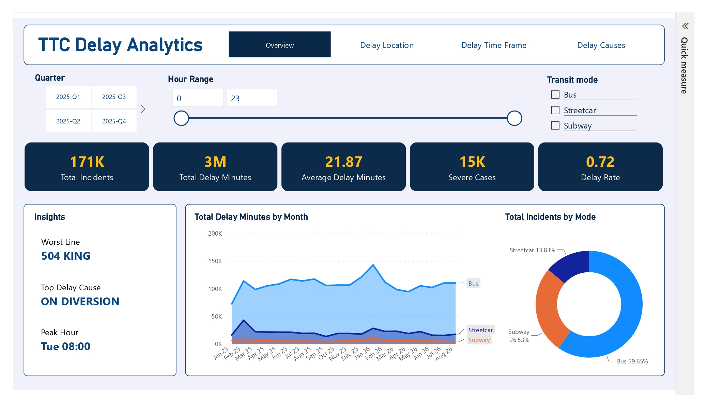
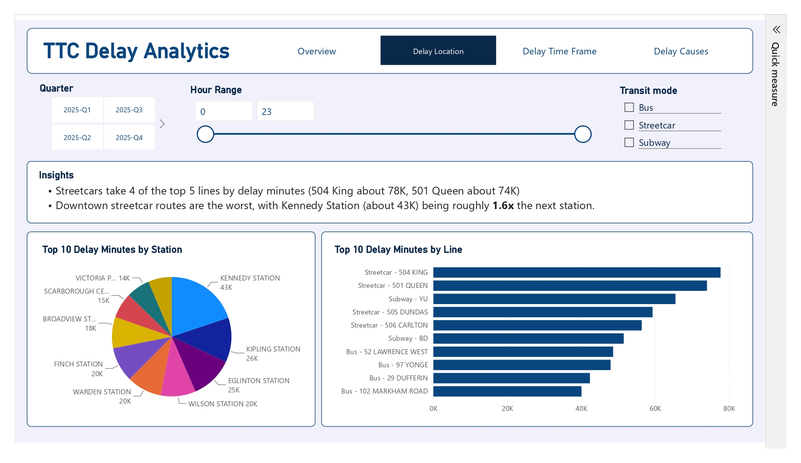
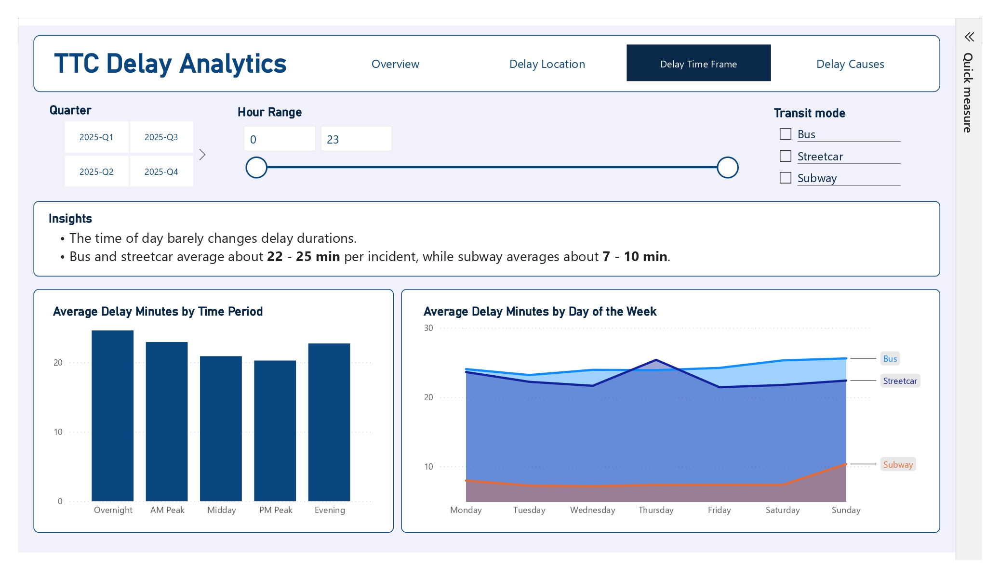
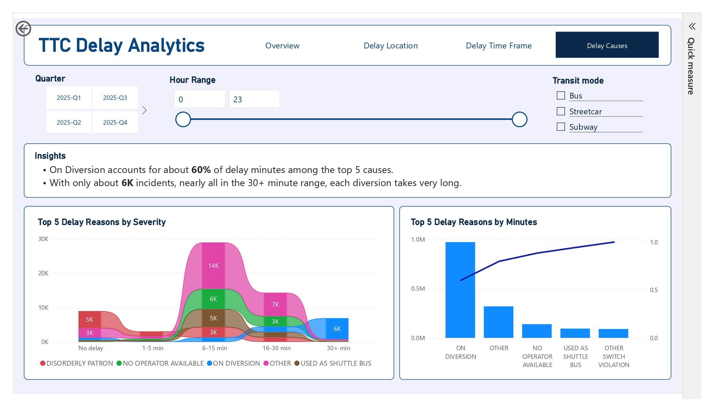

# **TTC Delay Analytics Dashboard**

**An automated end-to-end ETL pipeline and interactive Power BI dashboard tracking operational KPIs and delay trends across Toronto's transit network.**

---
## Project Preview

## Data Source
* **[City of Toronto Open Data Portal](https://open.toronto.ca/)**: Ingested **140,000+ TTC transit records** directly from the public Open Data REST API.

## Technologies Used
* **Python (Requests, Pandas)**
* **SQL (SQLite)**
* **Power BI (Power Query, DAX)**

## Key Features
* Automated extract, transform, and load (ETL) live transit metrics into a local database.
* Resolve critical text-encoding anomalies (such as broken em-dashes and corrupted characters) using Power Query.
* Structured reusable SQL views within an SQLite database.
* Multi-page Power BI dashboard.

